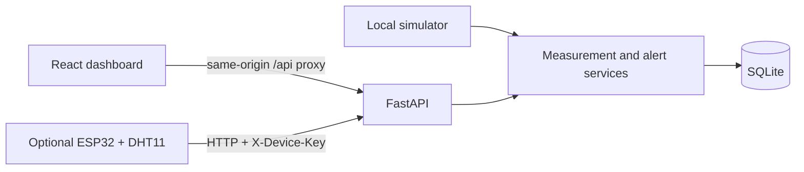
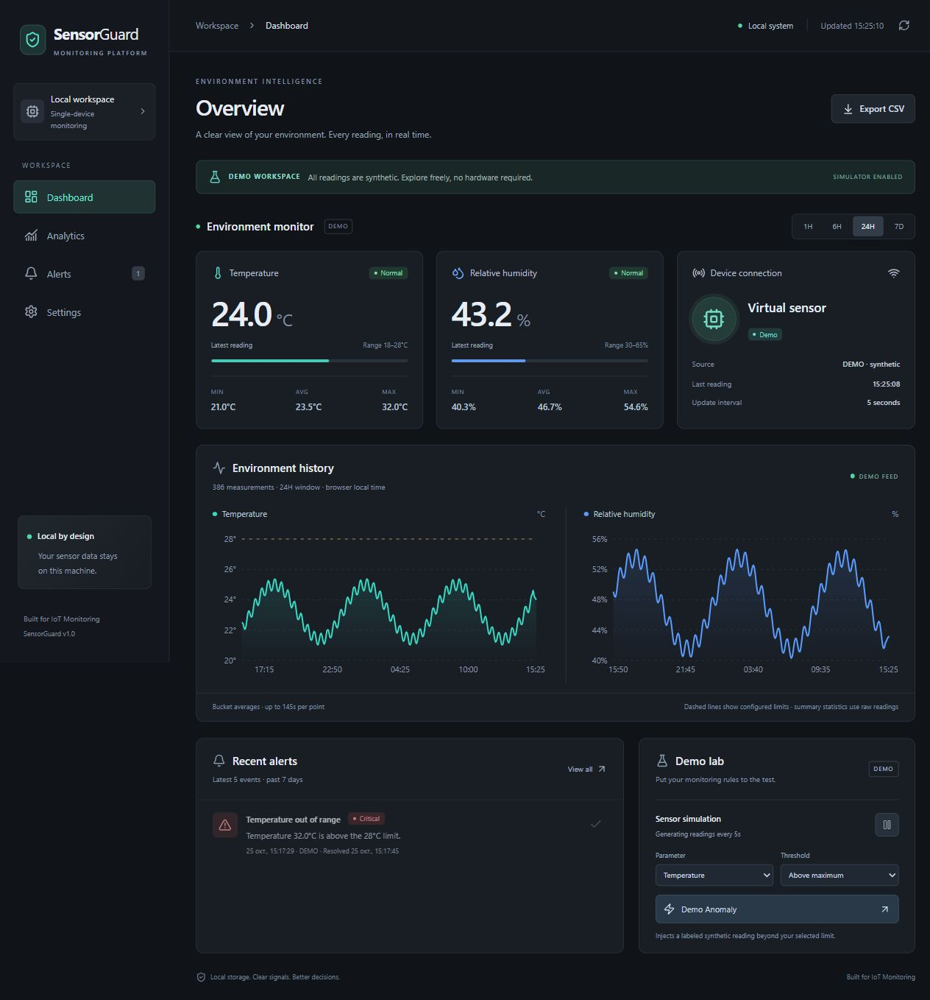

# SensorGuard

**A local IoT monitoring and alert platform. Built for IoT Monitoring.**

Monitor temperature and humidity, explore history, and test threshold alerts in a polished dark dashboard. SensorGuard starts in **DEMO mode** with clearly labeled synthetic measurements. No physical sensor, cloud service, account, paid API, or Docker is required.

## Features

- Live dashboard: temperature, humidity, source, connection freshness, and per-metric severity.
- Smooth simulator, 24 hours of initial history, 5-second updates, pause/resume, and selectable temperature/humidity high/low demo anomalies.
- Dashboard, Analytics, Alerts, and Settings with responsive layouts, keyboard controls, loading/error/empty states, and toast notifications.
- 1H / 6H / 24H / 7D history, raw-data mean/min/max, event counts, and CSV export.
- Persistent thresholds and operating mode; separate DEMO and hardware history.
- Deduplicated alerts, read acknowledgment, and recorded recovery times.
- Optional ESP32 + DHT11 HTTP ingestion with a device API key.
- SQLite persistence, OpenAPI documentation, backend and frontend tests.

## Tech stack

React 19 · TypeScript · Vite · Tailwind CSS 4 · Recharts · Lucide React · Python · FastAPI · Pydantic · SQLAlchemy · SQLite.

## Architecture



The Vite development/preview server proxies `/api` to `127.0.0.1:8000`. The browser needs no CORS exception or device secret. SQLAlchemy handles storage; Pydantic validates incoming values. A lifespan-managed task checks the simulator every second and records at most once per five seconds. SQLite `BEGIN IMMEDIATE` and a persisted last-tick value serialize writes and prevent duplicate simulator samples across overlapping processes. Shutdown cancels the task; restarts reuse existing settings and history. Use one Uvicorn worker for this local application.

## Screenshots

These are genuine captures of the running application with explicitly labeled DEMO data.



[Mobile dashboard screenshot](docs/screenshots/mobile.png)

## Installation — Windows 11

Install **Python 3.11 or newer** and **Node.js 22.12 or newer**, with both on PATH. Internet access is needed to install packages; the running application does not require it. Run these commands from the repository root in PowerShell:

```powershell
python -m venv .venv
.\.venv\Scripts\python.exe -m pip install -r requirements.txt
Set-Location frontend
npm.cmd ci
Set-Location ..
```

Activation is optional: the commands use the virtual environment interpreter directly. `npm.cmd` avoids PowerShell script execution-policy problems. If Python is available only through its launcher, replace the first `python` with `py -3`.

An `.env` file is optional in Demo mode. To customize the database or enable hardware:

```powershell
Copy-Item .env.example .env
```

Edit `.env` locally. Existing process environment variables take precedence. Relative database paths resolve from the repository root, not the launch directory. Never commit `.env`, the SQLite database, or firmware `config.h`.

### How to run

Terminal 1, repository root:

```powershell
.\.venv\Scripts\python.exe -m uvicorn backend.app.main:app --host 127.0.0.1 --port 8000
```

Terminal 2, repository root:

```powershell
Set-Location frontend
npm.cmd run dev
```

Open **http://127.0.0.1:5173**. API docs: **http://127.0.0.1:8000/docs**. Stop each server with Ctrl+C. After restarting, saved history and thresholds remain. For Python development, optionally append `--reload` to Uvicorn.

Convenience scripts are available in `scripts/`: `setup.ps1`, `start-backend.ps1`, and `start-frontend.ps1`. If your organization blocks PowerShell scripts, use the direct commands above; no execution policy change is needed.

### Production build for a local demo

```powershell
Set-Location frontend
npm.cmd run build
npm.cmd run preview
```

Keep the backend running. Preview serves the built files with the same `/api` proxy. Vite preview is for local demonstrations, not an internet-facing deployment.

## Demo mode and a three-minute walkthrough

1. Launch both servers and open the dashboard. The green DEMO banner identifies synthetic data throughout the interface.
2. On first database creation, 289 readings spanning 24 hours are seeded at five-minute intervals. Live data then arrives every five seconds. Restarting does not seed again.
3. Change the period and inspect chart tooltips. Values and times come from the API.
4. In **Demo lab**, select a parameter and direction, then click **Demo Anomaly**. It inserts a critical reading, holds it for about 15 seconds, and records an alert. If a threshold lies too close to the physical input boundary, the API explains why the selected anomaly cannot be generated.
5. See the toast and recent event, then open **Alerts** and mark it read. Once the next normal sample arrives, the event gets a recovery time. With simulation paused, recovery waits until simulation resumes or another reading is inserted.
6. Change limits in **Settings** and save. Fresh readings are evaluated immediately against the new limits.
7. Export CSV. Every row includes the UTC timestamp and `demo` or `hardware` source.

The simulator uses continuous sine waves with multiple periods, not AI predictions. Default values remain within default thresholds. Custom narrow limits may make ordinary simulator readings abnormal. Disabling simulation preserves history. The device becomes **Offline** after 20 seconds without data; the interface retains and labels the last known value. Switching to Hardware disables demo recording without deleting its history; switching back resumes it if enabled.

## Alert rules

| State | Temperature | Relative humidity |
|---|---|---|
| Normal | Within inclusive minimum/maximum | Within inclusive minimum/maximum |
| Warning | Outside a limit by less than 3°C | Outside a limit by less than 10 percentage points |
| Critical | At least 3°C beyond a limit | At least 10 percentage points beyond a limit |

An episode is tracked separately by source and metric. Consecutive values with the same severity and direction do not create duplicate alerts. Severity/direction changes close the previous event and create a new one. Normal readings close active events. Acknowledging an event changes only its read state; it does not normalize the sensor. Offline status does not imply recovery. Threshold edits re-evaluate fresh readings; stale readings wait for a new sample. Alert counts count events, including severity transitions, not the number of abnormal measurements. Dashboard recent alerts cover seven days; the Alert center supports period filtering and pagination.

## Data, time, and limits

- SQLite stores Unix timestamps in UTC. API and CSV serialize ISO 8601 UTC with `Z`. The browser formats timestamps in its local timezone (including DST).
- Hardware readings use server receipt time; the device cannot inject historical or future timestamps.
- API periods are `1h`, `6h`, `24h`, and `7d`. Measurements return bucket means (default at most 600 points, configurable 20–2,000). Chart metadata explains the bucket size. Short spikes may be averaged in charts; raw-data maxima and alert events retain them.
- Statistics and CSV use raw readings, not chart averages. CSV exports at most 150,000 rows; larger requests return HTTP 413 and require a shorter period.
- Alert pages contain at most 200 events (20 in the UI). Database data is not automatically deleted. Only the last seven days are browsable/exportable through the current API; older rows remain in SQLite.
- No reading is invented to fill a hardware gap. Hardware starts empty until a valid reading arrives. Graph lines connect available points; they are not evidence of continuous coverage.
- Temperature input bounds: −40 to 80°C; humidity: 0–100%. These are application validation bounds, not a claim about DHT11 accuracy or supported measurement range.

## ESP32 integration (optional)

Demo mode works independently of every step in this section. The sketch is in `firmware/SensorGuard/SensorGuard.ino`.

### Wiring

Use an ESP32 development board and a DHT11 sensor/module. Confirm the pin labels on your particular module; pin order varies.

| DHT11 connection | ESP32 connection |
|---|---|
| VCC | Sensor-rated power supply (use 3.3V only if supported by your sensor/module) |
| GND | GND |
| DATA | GPIO 4 (configurable) |
| NC on a bare four-pin sensor | Leave disconnected |

A bare DHT11 needs a roughly 10 kΩ pull-up from DATA to **3.3V**. Modules may already have a pull-up. Keep the ESP32 input at 3.3V logic; if a 5V-powered module pulls DATA to 5V, use appropriate level shifting or a compatible module. See the [Adafruit wiring guide](https://learn.adafruit.com/dht?view=all) and your module's datasheet.

### Firmware and server

1. In Arduino IDE install the **esp32 by Espressif Systems** board package, **DHT sensor library by Adafruit**, and its **Adafruit Unified Sensor** dependency.
2. Copy `firmware/SensorGuard/config.example.h` to `firmware/SensorGuard/config.h`. Fill in Wi-Fi SSID/password, the PC's LAN IP in `SERVER_URL`, and a device key. These values stay in the ignored file.
3. Set the same key as `SENSORGUARD_DEVICE_KEY` in the root `.env`, then restart the backend. Generate a local key if needed with `python -c "import secrets; print(secrets.token_urlsafe(32))"`.
4. Bind the backend to your network interface for hardware access:

   ```powershell
   .\.venv\Scripts\python.exe -m uvicorn backend.app.main:app --host 0.0.0.0 --port 8000
   ```

5. Keep PC and ESP32 on the same trusted LAN. Allow the Python server through Windows Firewall for the private network if prompted; do not disable the firewall. `127.0.0.1` on the ESP32 is not your PC.
6. Select **Hardware** in Settings and save. Open the sketch, choose your ESP32 board and port, upload, then inspect Serial Monitor at 115200 baud.

The sketch reads every five seconds, skips invalid sensor readings, reconnects Wi-Fi, uses HTTP timeouts, and reports failed submissions. Each next reading is a new attempt; failed samples are not queued or retried with the same payload. Requests use `X-Device-Key`. Missing server configuration gives 503, a wrong key gives 401, and ingest while in Demo mode gives 409. No secret is returned to the browser. The transport follows [Espressif's HTTPClient API](https://github.com/espressif/arduino-esp32/blob/master/libraries/HTTPClient/src/HTTPClient.h).

This is a single-user trusted-LAN application. Device authentication protects ingest only; settings and demo controls do not have user authentication. LAN HTTP is unencrypted. Do not port-forward it to the public internet.

## API documentation

Interactive schemas and validation rules are at `/docs`; machine-readable definitions are at `/openapi.json`.

| Method | Route | Purpose |
|---|---|---|
| GET | `/api/health` | Database connectivity and service status |
| GET | `/api/current` | Latest active-source reading, levels, freshness, key-configured flag |
| GET | `/api/measurements?period=24h&limit=600` | Bounded chart history with aggregation metadata |
| GET | `/api/stats?period=24h` | Raw count, average/min/max, period alert count |
| GET | `/api/alerts?period=7d&limit=50&offset=0` | Active-source alert history and total |
| PATCH | `/api/alerts/{id}/read` | Mark one event read (404 if absent) |
| GET | `/api/settings` | Current settings |
| PUT | `/api/settings` | Validate and save the full settings object |
| POST | `/api/ingest` | Hardware JSON `{temperature, humidity}` with `X-Device-Key` |
| POST | `/api/demo/anomaly` | JSON `{metric: "temperature" or "humidity", direction: "high" or "low"}` |
| GET | `/api/export/csv?period=24h` | Raw, source-labeled CSV download |

Settings fields: `temperature_min`, `temperature_max`, `humidity_min`, `humidity_max`, `mode` (`demo` or `hardware`), and `simulation_enabled` (boolean). Limits are inclusive and minima must be strictly lower than maxima. Unknown fields, non-finite numbers, unsupported periods, and out-of-range readings are rejected with 422. Successful ingest/anomaly requests return 201.

## Project structure

```text
backend/
  app/                 # FastAPI factory, config, database, models, schemas, routers, services
  tests/               # Isolated SQLite API and domain tests
  data/                # Runtime database, ignored by Git
frontend/
  src/                 # React pages, reusable components, API client, types, styles, tests
  package-lock.json    # Reproducible Node dependency tree
firmware/SensorGuard/   # Arduino sketch and safe example configuration
scripts/               # Optional PowerShell setup and launch helpers
docs/                  # Verification notes and genuine screenshots, when available
.env.example
requirements.txt
LICENSE
```

## Testing

From the repository root:

```powershell
.\.venv\Scripts\python.exe -m pytest backend/tests -q
Set-Location frontend
npm.cmd test
npm.cmd run build
```

Backend tests use temporary SQLite files and never modify the demo database. They exercise seed/restart behavior, severity boundaries, deduplication/recovery, auth, validation, source isolation, settings, CSV, and concurrent simulator ticks. Frontend tests cover period selection, empty states, acknowledgment, display formatting, and settings validation. TypeScript is checked as part of the production build. See `docs/VERIFICATION.md` for what was actually executed during development.

## Troubleshooting

- **Backend unavailable:** confirm port 8000 and `/api/health`; start the frontend with Vite so its API proxy is active.
- **Port 5173 occupied:** stop your earlier frontend instance. The dev server uses strict port selection rather than silently changing its address.
- **No hardware readings:** check Hardware mode, matching local key, LAN IP, private firewall rule, sensor wiring, and Serial Monitor.
- **Offline after pause:** expected after 20 seconds. Resume simulation to restore fresh readings.
- **Seven-day chart has only one day:** only 24 hours are seeded. Coverage grows while the application runs.
- **Unexpected limits after restart:** settings persist by design. Reset them through Settings; do not remove an existing database casually.

## Future roadmap

- Multiple devices and per-room profiles.
- Retention configuration, database migrations, and long-range history browsing.
- Hysteresis and configurable alert cooldowns for noisy physical sensors.
- Optional MQTT adapter and local notification channels.
- Wider browser accessibility tests and firmware CI with real-device validation.

## License

MIT. See [LICENSE](LICENSE).
